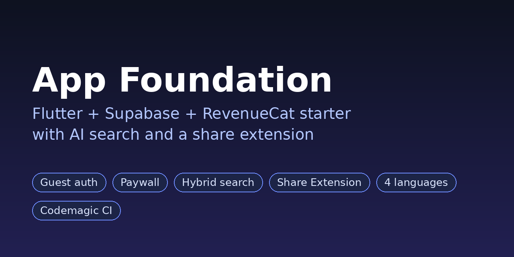

# App Foundation

[](https://github.com/sinanmurad/app-foundation/actions/workflows/analyze.yml)



**Flutter + Supabase + RevenueCat starter with AI search and a share extension.**
Ship a subscription-ready iOS/Android app without rebuilding the boring parts, and without owning a Mac.

[Türkçe README](README.tr.md) · License: MIT · [Contributing](CONTRIBUTING.md)

## No Mac. No Xcode. Built on Windows.

Most iOS starters quietly assume you own a Mac. This one does not.

Everything here was built and shipped from a **Windows PC**, with **no Mac and no local Xcode**:

- **iOS Share Extension without Xcode.** Adding an iOS Share Extension normally means clicking through Xcode. Here, `add_share_extension.rb` creates the extension target inside the Xcode project on the CI machine (Ruby + `xcodeproj`), so you get a Share Extension build with zero Mac access.
- **Android ShareActivity**, so the same share-to-app flow works on both platforms.
- **Codemagic → TestFlight** pipeline (`codemagic.yaml`) that signs, builds and uploads the iOS app for you.
- The same approach is used in a production app that is live on the App Store.

What is verified automatically here: every push and every Monday, GitHub Actions runs the preflight check, `flutter analyze` and an Android debug build. The iOS build runs on Codemagic in your own account (it needs your Apple credentials).

## What's inside

| Feature | Where |
|---|---|
| Supabase auth: guest (anonymous) sign-in, upgrade to Apple/email later | `lib/services/auth_service.dart` |
| Account deletion (required by the App Store) | `supabase/functions/delete-account` |
| Subscriptions + paywall (RevenueCat): `requirePro()`, restore, manage | `lib/services/subscription_service.dart` |
| LLM client with fallback: Groq → OpenRouter (`complete`, `completeJson`) | `lib/services/ai_service.dart` |
| Embeddings with fallback: Gemini → OpenRouter (768d) | `lib/services/embedding_service.dart` |
| Hybrid search: full-text + pgvector, merged with RRF | `supabase/migrations/0001_starter_base.sql`, `lib/services/item_repository.dart` |
| iOS Share Extension + Android ShareActivity (accepts any link/text) | `ios/ShareExtension`, `android/.../ShareActivity.kt` |
| Lossless share queue (nothing is lost if the app is closed) | `lib/services/share_service.dart` |
| Save shared item, then AI tagging + embedding in the background | `lib/services/share_pipeline.dart` |
| 4 languages (EN/TR/PT/ES) | `lib/l10n/*.arb` |
| Codemagic → TestFlight (no Mac needed, Share Extension included) | `codemagic.yaml`, `add_share_extension.rb` |
| Rename tool | `tool/rename.dart` |
| Pre-build check (ARB parity + hardcoded strings) | `tool/preflight.dart` |

Example screens: sign-in, list + search, settings (upgrade to Pro, restore
purchases, secure guest account, sign out, delete account). They are starting
points; change or delete them.

## Quick start

Click **Use this template → Create a new repository**, then:

```bash
git clone https://github.com/your-name/myapp
cd myapp

# Rename the app and bundle ID everywhere
dart tool/rename.dart --name "MyApp" --bundle com.yourcompany.myapp --team ABCDE12345

# Environment variables
cp .env.example .env      # Windows: copy .env.example .env
# fill in .env

flutter pub get
dart tool/preflight.dart
flutter analyze
```

AI keys are optional: without them the AI features are silently disabled and
the app still runs. Without RevenueCat keys the app runs without subscriptions.
Only `SUPABASE_URL` and `SUPABASE_ANON_KEY` are required.

## Setup checklist for each new app

**Supabase (a new project per app)**
- [ ] Run `supabase/migrations/0001_starter_base.sql` in the SQL Editor
- [ ] Authentication > Providers > enable **Anonymous Sign-Ins**
- [ ] Authentication > Providers > enable **Apple**
- [ ] Authentication > enable **Manual Linking** (guest → Apple)
- [ ] `supabase functions deploy delete-account`

**Apple Developer / App Store Connect**
- [ ] Register bundle ID `com.company.app` (Sign in with Apple + App Groups)
- [ ] Register bundle ID `com.company.app.ShareExtension` (App Groups)
- [ ] Create App Group `group.com.company.app` and add it to both IDs
- [ ] Create the app in App Store Connect, primary language **English (U.S.)**

**RevenueCat** (skip the keys and the app runs without subscriptions)
- [ ] Create subscription products in App Store Connect (monthly + yearly, same group)
- [ ] RevenueCat: new project → add iOS app (bundle ID + App Store Connect API key)
- [ ] Create an entitlement with the id exactly **`pro`** and attach the products
- [ ] Create the Current offering and add packages
- [ ] Design the paywall in the Paywalls section (no code needed)
- [ ] Add `REVENUECAT_IOS_KEY` / `REVENUECAT_ANDROID_KEY` to `.env` and Codemagic

Gate a feature behind Pro:

```dart
if (await SubscriptionService.instance.requirePro()) {
  // user is Pro: run the feature
}
```

**Codemagic**
- [ ] Connect the repo; add the 7 keys from `.env.example` to the `app_secrets` group
- [ ] The App Store Connect integration must be named `Codemagic` (or edit `codemagic.yaml`)

**Your app**
- [ ] Replace icons: `ios/Runner/Assets.xcassets/AppIcon.appiconset` and `android/app/src/main/res/mipmap-*` (currently a generic placeholder)
- [ ] Brand color: `lib/theme/app_theme.dart` → `kBrandColor` (plus the button color in `ShareViewController.swift` and `ShareActivity.kt`)
- [ ] Adapt the `items` table to your main entity; add new tables to `USER_TABLES` in `delete-account`
- [ ] No share extension needed? Delete `ios/ShareExtension`, Android `ShareActivity` and its manifest entry

## Rules

- Before every build: `dart tool/preflight.dart` + `flutter analyze` with zero errors. Codemagic runs this automatically; the build stops if ARB keys differ.
- New UI text → add the key to all 4 ARB files first, then use `AppLocalizations.of(context)!.key`.
- Groq does not work on web (CORS); test on a device or simulator.
- Never commit `.env`, `*.p8` or keystore files (already in `.gitignore`).

## License

MIT, see [LICENSE](LICENSE).
